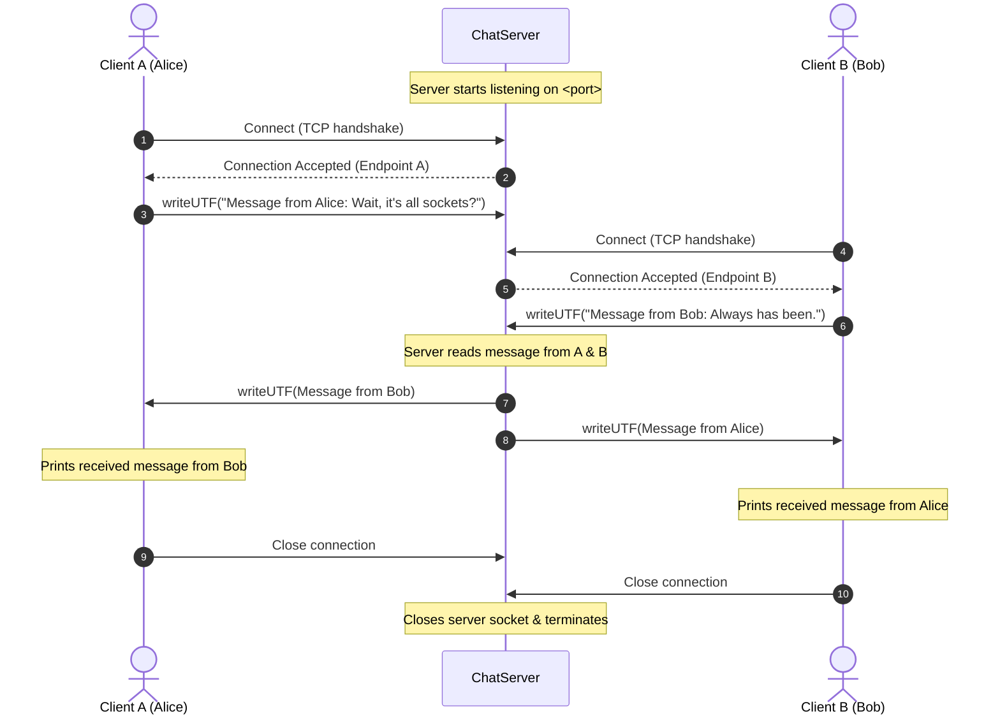

# SocketRelay-CSNETWK: Two-Client TCP Socket Chat Relay

[](https://www.oracle.com/java/)
[](https://www.dlsu.edu.ph/)
[]()
[]()

A Java TCP socket programming implementation created for **CSNETWK (Computer Networks)** at **De La Salle University (DLSU)**. The application demonstrates multi-client TCP network communication where a central server coordinates connection acceptance, receives payloads from two independent clients, and relays/swaps their messages before gracefully terminating connections.

---

## 👥 Authors & Academic Context

- **Guillarte, Dana Louise A.**
- **So, Chrysille Grace L.**
- **Course:** CSNETWK (Computer Networks)
- **Term:** Academic Year 2024–2025, Term 3
- **Assessment:** Laboratory 04 — Two-Client Socket Communication

---

## 📌 Project Overview

In traditional peer-to-peer communication, network address translation (NAT) and firewall traversal can complicate direct connections between two endpoints. This project demonstrates a **mediated two-client message exchange** pattern:

1. **`ChatServer`** ([src/ChatServer.java](file:///c:/Users/asus/OneDrive/Desktop/Socket-Programming-2/src/ChatServer.java)):
   - Listens on a designated TCP port.
   - Waits for and accepts incoming connections from **Client A** and **Client B** in sequence.
   - Reads a serialized string payload (`writeUTF` / `readUTF`) from each client.
   - Relays **Client B's message to Client A** and **Client A's message to Client B**.
   - Closes connections and terminates cleanly.

2. **`ChatClient`** ([src/ChatClient.java](file:///c:/Users/asus/OneDrive/Desktop/Socket-Programming-2/src/ChatClient.java)):
   - Connects to the server given an IP address/hostname and port number.
   - Transmits a message tagged with the user's name: `"Message from <username>: <message>"`.
   - Blocks awaiting the swapped response from the other client relayed by the server.
   - Prints the received payload and terminates.

---

## 🔄 Network Communication Flow



---

## 🗂️ Project Directory Structure

```text
SocketRelay-CSNETWK/
│
├── .gitignore                          # Git ignore rules for compiled classes & IDE cache
├── README.md                           # Comprehensive project documentation
│
├── docs/                               # Assessment deliverables and documentation
│   └── CSNETWK_Lab04_GuillarteSo.png   # Verified execution screenshot
│
├── src/                                # Java source files
│   ├── ChatServer.java                 # TCP Socket Relay Server implementation
│   └── ChatClient.java                 # TCP Socket Client implementation
│
├── bin/                                # Compiled .class bytecode (gitignored)
│
└── scripts/                            # Helper automation scripts
    ├── run_server.bat                  # Builds and launches ChatServer on port 4000
    └── run_clients.bat                 # Launches Client A and Client B sequentially
```

---

## 🖥️ Frontend Assessment

- **Current Implementation:** Pure **Command-Line Interface (CLI)** / Console Application.
- **Frontend Present:** **No graphical user interface (GUI) or web frontend** is included in this repository.
- **Recommended Frontend Enhancements:**
  1. **Desktop GUI (Swing / JavaFX):**
     - A dual-panel chat window showing connection status, outgoing message inputs, and incoming relay messages in real-time.
  2. **Web Frontend (WebSockets + HTML/CSS/JS):**
     - A lightweight Node.js or Spring Boot relay bridging raw TCP sockets to a WebSocket endpoint, connected to a modern web interface.

---

## 🚀 How to Build and Run

### Prerequisites
- **Java Development Kit (JDK 8 or later)** installed and available on your PATH (`javac` and `java`).

### Option A: Using Helper Scripts (Windows)
1. In a terminal, run the server script:
   ```cmd
   scripts\run_server.bat 4000
   ```
2. In another terminal, run the clients script:
   ```cmd
   scripts\run_clients.bat 4000
   ```

### Option B: Manual Terminal Execution

#### 1. Compile the Source Code
Compile the Java source files into the `bin/` directory:
```bash
javac -d bin src/ChatServer.java src/ChatClient.java
```

#### 2. Start the Server
Open a terminal and start the server with your desired port number (e.g., `4000`):
```bash
java -cp bin ChatServer 4000
```
*Expected Server Output:*
```text
Server: Listening on port 4000...
```

#### 3. Run Client A
Open a second terminal window and run Client A:
```bash
java -cp bin ChatClient localhost 4000 "Alice" "Wait, it's all sockets?"
```
*Expected Client A Output:*
```text
Client: Connected to server at localhost/127.0.0.1:4000
```
*(Client A will pause while waiting for Client B to connect and reply).*

#### 4. Run Client B
Open a third terminal window and run Client B:
```bash
java -cp bin ChatClient localhost 4000 "Bob" "Always has been."
```

---

## 📊 Sample Output Verification

### Server Terminal
```text
Server: Listening on port 4000...
Server: New client connected: /127.0.0.1:55226
Server: New client connected: /127.0.0.1:55228
Server: Received from Client A: Message from Alice: Wait, it's all sockets?
Server: Received from Client B: Message from Bob: Always has been.
Server: Connection is terminated.
```

### Client A Terminal (Alice)
```text
Client: Connected to server at localhost/127.0.0.1:4000
Client: Received -> Message from Bob: Always has been.
Alice: Connection is terminated.
```

### Client B Terminal (Bob)
```text
Client: Connected to server at localhost/127.0.0.1:4000
Client: Received -> Message from Alice: Wait, it's all sockets?
Bob: Connection is terminated.
```

A full verified execution screenshot can be viewed in [docs/CSNETWK_Lab04_GuillarteSo.png](file:///c:/Users/asus/OneDrive/Desktop/Socket-Programming-2/docs/CSNETWK_Lab04_GuillarteSo.png).

---

## 🛡️ Error Handling & Edge Cases Addressed

- **Input Argument Validation:** Added boundary checks on `args[]` for both server and client to display usage guidelines instead of throwing uncaught `ArrayIndexOutOfBoundsException` when launched without parameters.
- **Null Safety:** Explicitly initialized socket references ensuring clean resource lifecycle tracking.
- **Port Reuse:** Streams and sockets close cleanly in sequence, freeing the OS TCP port for subsequent runs.
